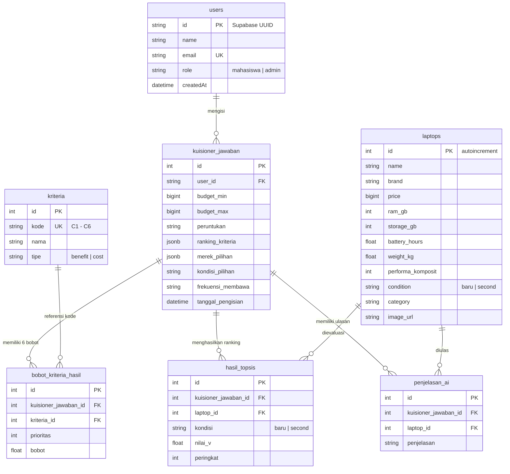

# Laporan Hasil Analisis Arsitektur & Rekomendasi Pengembangan Lapmatch

Dokumen ini disusun menggunakan panduan skill **Replica Recon** untuk memetakan secara komprehensif struktur proyek, seluruh halaman, fungsionalitas fitur, alur pengguna (*user flows*), sistem autentikasi, kuesioner pendukung keputusan (SPK), serta permodelan basis data pada platform **Lapmatch** (`rekomendasi-laptop-next`).

---

## 1. Ringkasan Eksekutif & Karakteristik Proyek

**Lapmatch** adalah aplikasi web Sistem Pendukung Keputusan (SPK) multi-kriteria berbasis ilmiah yang dirancang khusus untuk membantu mahasiswa dan pengguna umum di Indonesia menentukan pilihan laptop paling ideal sesuai anggaran dan peruntukan komputasi mereka.

Platform ini memadukan:
1. **Algoritma Pembobotan ROC (*Rank Order Centroid*)**: Menentukan bobot relatif kriteria secara objektif berdasarkan urutan prioritas kebutuhan.
2. **Algoritma Evaluasi TOPSIS (*Technique for Order Preference by Similarity to Ideal Solution*)**: Menghitung kedekatan relatif setiap alternatif laptop terhadap solusi ideal positif dan negatif.
3. **Kecerdasan Buatan (Google Gemini 1.5 Flash + Fallback Generator)**: Menghasilkan penalaran naratif personal dalam Bahasa Indonesia yang ramah dan solutif.
4. **Pemisahan Kondisi Baru vs Second**: Memberikan komparasi peringkat terpisah yang adil (*apple-to-apple*) untuk alternatif baru dan laptop bekas berkualitas.
5. **Transparansi Akademis**: Menyediakan modal pembuktian matematis langkah demi langkah (Matriks Keputusan, Normalisasi, Normalisasi Terbobot, Solusi Ideal, Jarak Solusi, dan Nilai Preferensi V).

---

## 2. Struktur Proyek & Tech Stack

Proyek ini dibangun di atas pondasi teknologi modern:

```
rekomendasi-laptop-next/
├── prisma/
│   ├── migrations/               # Riwayat migrasi skema SQL PostgreSQL
│   ├── schema.prisma             # Definisi skema model database relasional
│   └── seed.ts                   # Data awal (kriteria C1-C6, sampel laptop baru/second)
├── public/                       # Aset publik statis (logo, ilustrasi, icons)
├── replica/                      # Dokumen luaran Replica Recon & Analisis
│   ├── recon.md                  # Recon Map standar Replica
│   ├── features.csv              # Matriks fitur komparatif
│   └── analysis-and-recommendations.md
├── src/
│   ├── app/                      # Next.js App Router (Halaman & API Routes)
│   │   ├── admin/                # Dashboard Admin terpusat (8 modul manajemen)
│   │   ├── api/                  # Route handlers backend (auth, questionnaire, laptops, banners)
│   │   ├── auth/callback/        # OAuth & Magic Link callback handler
│   │   ├── forgot-password/      # Formulir permohonan reset sandi
│   │   ├── history/              # Halaman riwayat hasil konsultasi
│   │   ├── kebijakan-privasi/    # Halaman legalitas privasi
│   │   ├── login/                # Halaman masuk (Email & Google OAuth)
│   │   ├── profile/              # Profil pengguna & pengaturan akun
│   │   ├── questionnaire/        # Formulir kuesioner 5 parameter kebutuhan
│   │   ├── recommendation/[id]/  # Halaman hasil evaluasi & pemeringkatan SPK
│   │   ├── register/             # Halaman registrasi akun baru
│   │   ├── reset-password/       # Formulir input kata sandi baru
│   │   ├── service-laptop/       # Direktori tempat service & diagnosa kerusakan
│   │   ├── syarat-penggunaan/    # Ketentuan layanan
│   │   ├── tentang/              # Latar belakang platform Lapmatch
│   │   ├── tentang-metode/       # Edukasi ilmiah metode ROC dan TOPSIS
│   │   ├── LaptopCatalog.tsx     # Komponen eksplorasi & filter katalog laptop
│   │   ├── layout.tsx            # Root layout, font, toast provider
│   │   └── page.tsx              # Beranda (mode Tamu landing page vs mode Pengguna dashboard)
│   ├── components/               # Komponen antarmuka modular
│   │   ├── auth/                 # Input, PasswordInput, GoogleButton, AuthPromptModal
│   │   ├── ui/                   # Komponen visual (PerspectiveTunnel, dll.)
│   │   ├── FeaturedLaptopAdBanner.tsx
│   │   ├── Footer.tsx
│   │   ├── LandingPage.tsx
│   │   ├── LaptopCompareModal.tsx
│   │   ├── LaptopDetailModal.tsx
│   │   ├── LaptopReviewModal.tsx
│   │   ├── Navbar.tsx
│   │   └── TopsisStepByStepModal.tsx
│   ├── data/
│   │   └── service-shops.ts      # Direktori data service center & masalah laptop
│   ├── lib/
│   │   ├── supabase/             # Client, Server, Admin, dan Middleware/Proxy session Supabase
│   │   ├── ai.ts                 # Integrasi Gemini 1.5 Flash + fallback narasi kontekstual
│   │   ├── auth-constants.ts     # Konfigurasi role, whitelist superadmin, sanitizer role
│   │   ├── banner-store.ts       # Manajemen data banner promo
│   │   ├── laptop-utils.ts       # Helper format rupiah, image loader, link marketplace
│   │   ├── prisma.ts             # Inisialisasi Prisma Client singleton
│   │   ├── rate-limit.ts         # In-memory sliding window rate limiter untuk API/Auth
│   │   ├── roc.ts                # Rumus matematika Rank Order Centroid
│   │   └── topsis.ts             # Algoritma komputasi TOPSIS lengkap & imputasi spesifikasi
│   └── proxy.ts                  # Next.js 16 proxy session middleware
```

### Rincian Versi Paket Kunci:
- **Framework**: `Next.js 16.3.8` (App Router, konvensi `proxy.ts`)
- **UI Engine**: `React 19.2.8` & `Tailwind CSS v4`
- **ORM & Database**: `Prisma 7.10.0` dengan adapter `@prisma/adapter-pg` & `PostgreSQL` (via Supabase)
- **Autentikasi**: `@supabase/ssr 0.12.7` & `@supabase/supabase-js 2.117.2`
- **Animasi & Ikon**: `framer-motion 14.9.0` & `lucide-react 1.49.0`
- **Form & Validasi**: `react-hook-form 7.89.0` + `zod 4.6.5`
- **Data Export/Import**: `xlsx 0.18.5`

---

## 3. Identifikasi Halaman & Fitur Lengkap

Platform Lapmatch memiliki 16 layar utama dan komponen modal:

1. **Beranda / Landing Page (`/`)**:
   - Menampilkan layout bersyarat (*conditional layout*):
     - **Mode Tamu (Guest)**: Hero visual interaktif, ringkasan manfaat sistem SPK, preview laptop populer, testimoni pengguna, dan tombol ajakan bertindak (CTA).
     - **Mode Pengguna (Logged-in)**: Kartu konsultasi terbaru, tombol cepat mulai kuesioner, statistik aktivitas, serta katalog laptop lengkap.
2. **Katalog Laptop & Filter Interaktif (`LaptopCatalog.tsx`)**:
   - Pencarian kata kunci instan (nama/tipe laptop).
   - Filter harga multi-level, filter merek dinamis, filter kategori (Gaming, Bisnis, Ultrabook, Kuliah), dan filter kondisi (Baru / Second).
   - Tombol cepat bandingkan laptop (hingga 3 laptop sekaligus).
3. **Modal Detail Spesifikasi (`LaptopDetailModal.tsx`)**:
   - Rincian spesifikasi teknis lengkap: Processor, GPU/VGA, RAM, SSD/HDD, Baterai, Bobot, Layar, dan Dimensi.
   - Indikator skor performa dan mobilitas.
   - Tombol rujukan ke marketplace resmi (Tokopedia, Shopee, Blibli).
4. **Modal Komparasi Berdampingan (`LaptopCompareModal.tsx`)**:
   - Menyandingkan 2 hingga 3 laptop secara visual kolom per kolom dengan penanda spesifikasi yang lebih unggul.
5. **Halaman Kuesioner Rekomendasi (`/questionnaire`)**:
   - **Mode Panduan**: Pengunjung dapat membaca metodologi evaluasi sebelum memulai.
   - **Formulir 5 Parameter**:
     - *Rentang Anggaran*: Slider minimal & maksimal dengan preset anggaran populer mahasiswa.
     - *Peruntukan Komputasi*: Kuliah & Tugas, Programming, Desain Grafis, Gaming, Bisnis (bisa pilih hingga 2).
     - *Frekuensi Pemakaian*: 1-2 hari, 3-4 hari, 5-6 hari, setiap hari.
     - *Preferensi Kondisi*: Baru, Second, atau Keduanya.
     - *Preferensi Merek*: Multi-select atau Semua Merek.
   - Terintegrasi `AuthPromptModal` yang mencegah kehilangan data input jika pengunjung belum login.
6. **Halaman Hasil Rekomendasi (`/recommendation/[id]`)**:
   - Tab pemisahan hasil: Laptop Baru (Top 5) & Laptop Second (Top 5).
   - Kartu pemenang dengan lencana peringkat (*Gold/Silver/Bronze*), skor kecocokan persentase, dan rincian keunggulan spesifikasi.
   - Kotak penjelasan narasi AI Gemini yang personal.
   - Opsi cetak laporan rekomendasi dengan styling PDF siap cetak (tanpa elemen navigasi).
7. **Modal Transparansi Perhitungan TOPSIS (`TopsisStepByStepModal.tsx`)**:
   - Menyajikan pembuktian ilmiah matriks:
     - Matriks Keputusan Alternatif $X$
     - Matriks Ternormalisasi $R$
     - Matriks Ternormalisasi Terbobot $Y$
     - Solusi Ideal Positif ($A^+$) dan Solusi Ideal Negatif ($A^-$)
     - Jarak Euclidean Separasi ($D^+$ dan $D^-$)
     - Nilai Preferensi Relatif $V$ dan Peringkat Akhir.
8. **Halaman Riwayat Konsultasi (`/history`)**:
   - Menampilkan seluruh hasil pengisian kuesioner pengguna terdahulu dengan pagination dan fitur pencarian judul.
   - Kemampuan menghapus riwayat individual secara permanen dengan *cascading delete*.
9. **Halaman Direktori Service Laptop & Diagnosa (`/service-laptop`)**:
   - Direktori toko service terverifikasi dengan filter kota, alamat lengkap, dan tautan langsung WhatsApp.
   - Modul diagnosa mandiri gejala kerusakan (laptop panas, lemot, layar retak, mati total) lengkap dengan perkiraan estimasi biaya perbaikan.
10. **Halaman Masuk / Login (`/login`)**:
    - Input Email dan Password dengan tombol toggle visibilitas kata sandi.
    - Tombol Google OAuth.
    - Sistem pembatasan laju (*Rate Limiting*) proteksi serangan *brute force*.
11. **Halaman Pendaftaran / Registrasi (`/register`)**:
    - Validasi format email, kelayakan nama, dan `PasswordStrengthMeter` interaktif 4-level.
12. **Halaman Lupa Sandi & Reset Password (`/forgot-password`, `/reset-password`)**:
    - Alur pemulihan kata sandi via email dengan verifikasi token Supabase Auth.
13. **Halaman Profil Pengguna (`/profile`)**:
    - Menampilkan informasi akun, role, statistik jumlah konsultasi, dan pintasan ganti kata sandi atau logout.
14. **Dashboard Admin Terpadu (`/admin`)**:
    - Terdiri dari 8 tab modul manajemen:
      1. *Dashboard Utama (Overview)*: Ringkasan statistik (total laptop, pengguna, konsultasi).
      2. *Manajemen Laptop*: Tabel data laptop, pencarian, form tambah/edit modal, hapus laptop.
      3. *Import Excel Modal*: Drag-and-drop file `.xlsx` untuk pembacaan dan penyimpanan data laptop massal.
      4. *Manajemen Pengguna*: Daftar akun terdaftar, filter peran (*mahasiswa* / *admin*).
      5. *Kuesioner & Kriteria*: Pemantauan aktivitas konsultasi pengguna dan parameter kriteria.
      6. *Ulasan & Rating*: Pengawasan review yang masuk.
      7. *Iklan & Banner Konten*: Pengaturan banner laptop unggulan di beranda.
      8. *Laporan & Ekspor Data*: Fitur unduh laporan terformat dalam berkas spreadsheet `.xlsx`.
15. **Halaman Informasi & Legalitas (`/tentang`, `/tentang-metode`, `/kebijakan-privasi`, `/syarat-penggunaan`)**:
    - Konten statis terstruktur yang menjelaskan landasan hukum, perlindungan privasi, serta pembuktian rumus ilmiah ROC & TOPSIS.

---

## 4. Alur Pengguna (User Flows)

```
[ Pengunjung / Tamu ]
         │
         ├───► Membaca Landing Page (S01) ───► Eksplorasi Katalog Laptop (S03)
         │                                            │
         │                                     Lihat Detail / Bandingkan (S04 / S05)
         │
         └───► Mengisi Kuesioner (S06)
                     │
                     ├─ Belum Login ──► AuthPromptModal ──► Login / Register (S11 / S12)
                     │                                              │
                     └─ Sudah Login ◄───────────────────────────────┘
                              │
                              ▼
                  [ POST /api/questionnaire ]
                              │
               ┌──────────────┴──────────────┐
               ▼                             ▼
        Kalkulasi Bobot ROC          Filter Laptop Kandidat
        (C1 - C6 berdasar            (Sesuai Budget, Kondisi,
         kebutuhan pemakaian)         Merek, RAM >= 4GB)
               └──────────────┬──────────────┘
                              │
                              ▼
                     Eksekusi Algoritma TOPSIS
                   (Diproses terpisah Baru & Second)
                              │
                              ▼
                     Panggilan AI Gemini 1.5
                   (Fallback ke generator narasi
                    bila limit / offline)
                              │
                              ▼
                  [ Halaman Hasil (S07) ]
                              │
         ┌────────────────────┼────────────────────┐
         ▼                    ▼                    ▼
Peringkat 1-5 Baru    Peringkat 1-5 Second    Cetak PDF / Laporan
         │                    │
         └──────────┬─────────┘
                    ▼
       Modal Detail Matematis (S08)
    (Audit Matriks X, R, Y, A+, D, V)
                    │
                    ▼
          Riwayat Konsultasi (S09)
         (Tersimpan untuk ditinjau ulang)
```

---

## 5. Analisis Sistem Login & Autentikasi

Arsitektur autentikasi Lapmatch memadukan **Supabase Auth** dengan sinkronisasi ke tabel lokal **Prisma (PostgreSQL)**:

### 1. Pola Supabase SSR & Next.js 16 Proxy
- Next.js 16 memperbarui konvensi *middleware* menjadi `proxy` (`src/proxy.ts`). Lapmatch mengadopsi struktur ini melalui fungsi `updateSession` (`src/lib/supabase/middleware.ts`) yang memperbarui cookie sesi secara aman pada setiap permintaan rute non-aset.
- Di sisi server (`src/lib/supabase/server.ts`), klien Supabase dibuat dengan akses `getAll()` dan `setAll()` cookies untuk memastikan token sesi selalu tersinkronisasi antara header browser dan SSR context.

### 2. Lapisan Keamanan & Proteksi Brute-Force
- Endpoint masuk (`/api/auth/login`) dilindungi mekanisme **Rate Limiting** berbasis sliding window (`src/lib/rate-limit.ts`) dengan kunci gabungan `login:<IP>:<Email>`.
- Jika terjadi kegagalan autentikasi lebih dari 5 kali dalam periode 15 menit, endpoint mengembalikan respon HTTP 429 (*Too Many Requests*) secara otomatis.
- Terdapat mekanisme *auto-confirm fallback* pada level Supabase Admin untuk mencegah akun baru yang belum menyelesaikan verifikasi email terjebak dalam status *unconfirmed*.

### 3. Autentikasi Google OAuth & Sinkronisasi Pengguna
- Tombol Google OAuth mengarahkan pengguna ke endpoint otentikasi Supabase dengan *callback URL* ke `/auth/callback`.
- Route handler `/auth/callback/route.ts` menukar kode pertukaran otentikasi (*code-for-session*) dan secara otomatis memastikan entitas pengguna telah terdaftar di tabel `users` Prisma dengan data `id` (UUID), `name`, `email`, dan `role: 'mahasiswa'`.

### 4. Proteksi Rute Tingkat Admin
- Halaman dashboard admin (`/admin/page.tsx`) menerapkan verifikasi ganda di level server sebelum merender antarmuka:
  1. Verifikasi sesi aktif pengguna via Supabase SSR.
  2. Pengecekan profil database: kolom `role` harus bernilai `'admin'` dan alamat email harus terdaftar dalam whitelist `isSuperAdminEmail` (`src/lib/auth-constants.ts`).

---

## 6. Analisis Kuesioner Rekomendasi Laptop & Mesin SPK

Inti komputasi Lapmatch terletak pada sinergi algoritma pendukung keputusan:

### 1. Enam Kriteria Standar SPK Lapmatch
Sistem menggunakan 6 kriteria terstandarisasi:
- **C1 - Harga** (Tipe: *Cost* — Semakin terjangkau nilainya semakin baik)
- **C2 - Performa** (Tipe: *Benefit* — Dihitung dari skor prosesor, VGA, dan benchmark komposit)
- **C3 - RAM** (Tipe: *Benefit* — Kapasitas multitasking dalam satuan GB)
- **C4 - Kapasitas Penyimpanan / Storage** (Tipe: *Benefit* — Kapasitas SSD/HDD dalam satuan GB)
- **C5 - Daya Tahan Baterai** (Tipe: *Benefit* — Daya tahan dalam jam pemakaian)
- **C6 - Portabilitas / Berat** (Tipe: *Cost* — Semakin ringan bobot kilogram semakin baik)

### 2. Metode Pembobotan ROC (Rank Order Centroid)
Pengguna tidak dibebani menentukan angka desimal bobot secara manual. Sistem mengonversi kebutuhan pemakaian (misal: *Programming* & *Mobilitas Tinggi*) menjadi urutan prioritas $1, 2, \dots, K$ ($K=6$). Rumus ROC menghitung bobot tiap kriteria ke-$i$:

$$W_i = \frac{1}{K} \sum_{j=i}^{K} \frac{1}{j}$$

Hasil dinormalisasi sehingga total $\sum_{i=1}^{K} W_i = 1.0000$.

### 3. Algoritma Evaluasi TOPSIS
1. **Konstruksi Matriks Keputusan ($X$)**: Ukuran $m \times n$ (alternatif laptop $\times$ kriteria). Dilengkapi fungsi *auto-impute* spesifikasi untuk mencegah nilai nol pada laptop lama.
2. **Normalisasi Matriks ($R$)**:
   $$r_{ij} = \frac{x_{ij}}{\sqrt{\sum_{k=1}^{m} x_{kj}^2}}$$
3. **Normalisasi Terbobot ($Y$)**:
   $$y_{ij} = w_j \cdot r_{ij}$$
4. **Penentuan Solusi Ideal ($A^+$ dan $A^-$)**:
   - Untuk kriteria *Benefit*: $y_j^+ = \max(y_{ij})$, $y_j^- = \min(y_{ij})$
   - Untuk kriteria *Cost*: $y_j^+ = \min(y_{ij})$, $y_j^- = \max(y_{ij})$
5. **Jarak Solusi Ideal ($D_i^+$ dan $D_i^-$)**:
   $$D_i^+ = \sqrt{\sum_{j=1}^n (y_{ij} - y_j^+)^2}, \quad D_i^- = \sqrt{\sum_{j=1}^n (y_{ij} - y_j^-)^2}$$
6. **Nilai Preferensi Kedekatan Relatif ($V_i$)**:
   $$V_i = \frac{D_i^-}{D_i^+ + D_i^-}$$
   Nilai $V_i$ berada pada rentang $0 \le V_i \le 1$. Nilai tertinggi menunjukkan alternatif laptop yang paling mendekati solusi ideal.

### 4. Integrasi AI Gemini & Resilience Guard
- Setelah peringkat 1 sampai 5 ditentukan, sistem memicu pemanggilan API `gemini-1.5-flash` (`src/lib/ai.ts`) dengan timeout 3.5 detik untuk menghasilkan rangkuman keunggulan laptop.
- Jika sambungan AI mengalami *rate limit*, kuota habis, atau timeout, sistem secara otomatis beralih ke `generateFallbackNarrative` (mesin naratif kontekstual berbasis aturan) sehingga pengguna tetap mendapatkan ulasan spesifikasi tanpa *error* atau hambatan pada antarmuka.

---

## 7. Analisis Database & Relasi Model

Skema database PostgreSQL dikelola melalui Prisma ORM dengan 7 tabel utama:



### Keunggulan Skema:
- Relasi terkonfigurasi dengan `onDelete: Cascade` pada tabel anak (`bobot_kriteria_hasil`, `hasil_topsis`, `penjelasan_ai`), menjamin integritas data saat riwayat konsultasi dihapus.
- Penggunaan tipe `BigInt` pada kolom harga (`price`, `budget_min`, `budget_max`) menjamin ketelitian nominal mata uang Rupiah tanpa batasan integer 32-bit.
- Penanganan serialisasi BigInt ke string sudah diterapkan pada seluruh API response JSON untuk mencegah *TypeError: Do not know how to serialize a BigInt*.

---

## 8. Temuan Teknis & Rekomendasi Pengembangan

Berdasarkan hasil pemindaian kode mendalam, berikut rekomendasi strategis untuk pengembangan tahap berikutnya:

### A. Rekomendasi Kinerja & Skalabilitas (Performance)
1. **Database Indexing Tambahan**:
   - Menambahkan indeks komposit pada tabel `laptops` untuk `(condition, price)` dan `(brand, price)` guna mempercepat query pencarian kandidat saat katalog bertambah menjadi ribuan unit.
   - Menambahkan indeks pada `kuisioner_jawaban(user_id, created_at)`.
2. **Caching Data Katalog Laptop**:
   - Memanfaatkan `unstable_cache` atau tag-based revalidation pada fungsi pemanggilan katalog laptop publik agar query database tidak berulang untuk data yang jarang berubah.

### B. Rekomendasi Fungsionalitas Fitur (Features Enhancement)
1. **Ekspor PDF Berkas Asli (Server-Side / Client Canvas)**:
   - Saat ini fitur cetak menggunakan perintah browser `window.print()`. Disarankan menambahkan pustaka pembuat PDF native (misalnya `@react-pdf/renderer` atau `html2pdf.js`) agar pengguna dapat langsung mengunduh file `.pdf` rapi dalam satu klik di perangkat seluler.
2. **Notifikasi Email Hasil Rekomendasi**:
   - Menyediakan opsi pengiriman ringkasan rekomendasi Top 3 beserta rincian spek ke alamat email pengguna melalui integrasi transactional email (Resend / SendGrid).
3. **Penyempurnaan Manajemen Ulasan Laptop (Community Reviews)**:
   - Tabel untuk ulasan pengguna di database dapat dibuat lebih formal dengan relasi `Review (id, userId, laptopId, rating, comment, createdAt)` agar ulasan komunitas tersimpan persisten di database PostgreSQL.

### C. Rekomendasi Keamanan & Best Practices (Security)
1. **Penyimpanan Rate Limit Terdistribusi**:
   - Modul `src/lib/rate-limit.ts` saat ini menggunakan *in-memory Map*. Untuk lingkungan multi-instance / serverless production (seperti Vercel atau cluster container), pertimbangkan integrasi Redis / Upstash KV agar batasan percobaan login tersinkronisasi lintas worker node.
2. **Sanitasi Konten & Input Excel**:
   - Pada fitur `ImportLaptopModal`, tambahkan validasi skema Zod per baris data Excel sebelum batch insert, guna memvalidasi format string dan mencegah injeksi karakter aneh pada nama laptop.

---

## 9. Kesimpulan

Project **Lapmatch** telah memiliki fondasi arsitektur perangkat lunak yang sangat matang, rapi, dan modular. Seluruh komponen penting (autentikasi SSR, alur kuesioner dinamis, kalkulator matematis ROC-TOPSIS, integrasi AI, serta dashboard admin) telah terintegrasi dengan baik.

Dokumen recon ini siap menjadi rujukan utama untuk tahapan lanjutan dalam **Replica Pack** (seperti perancangan arsitektur `/replica-architect` atau penyempurnaan desain sistem `/replica-design`).
